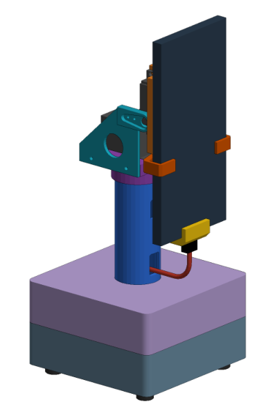

<table align="center">
<tr>
<td valign="middle"></td>
<td valign="middle"></td>
</tr>
</table>

<i>The companion on the phone, and a stand that is being designed for it (CAD render, work in progress).</i>

# 🦖 Androsaur

**English** | [Русский](README.ru.md)

**A companion for your home that looks after the people in it.**
Give an old phone a second life as a small living character. It sits next to you, knows who is in front of it, reminds you to
rest and to take your pills, passes on messages, and keeps the family's little things in mind. Most of this happens on the phone
itself, with no cloud.

  <a href="https://github.com/androsaurs/androsaur#quick-start"><b>▶ Try it</b></a>
  &nbsp;&nbsp;·&nbsp;&nbsp;
  <a href="https://github.com/androsaurs/.github/blob/main/CONTEXT.md#как-собирать-и-проверять"><b>🔧 Build it</b></a>
  &nbsp;&nbsp;·&nbsp;&nbsp;
  <a href="https://github.com/androsaurs/androsaur-stand/blob/main/docs/enclosure.md#печать-без-поддержек"><b>🖨 Print the stand</b></a>

## Meet your companion

A dinosaur on the screen that breathes, blinks, follows you with its eyes and talks. It falls asleep when nobody is around and
wakes up when you call its name or walk up.

It knows the family. When someone appears, it recognizes them and shows their name, and each person can have **their own
character**: a kitten, a puppy, a hamster, a penguin and others, some of which put on glasses when you ask. The first time you
meet in a day it greets you by name, tells you the weather ("take an umbrella, it will rain this evening") and, if you like, your horoscope.

## It looks after you

- **Digital wellbeing.** Working at your desk, you have a companion who notices how long you have been sitting. When it is time to rest, it asks you to get up, stretch or take a walk. The character gets tired, then exhausted, and says "well done" when you come back from a break.
- **Pill reminders.** Everyone has their own schedule. When the phone sees you in the time window, it reminds you to take your medicine, once, and notes it when you say "taken". The log reaches the home server, even if the connection comes back later.

## It helps around the house

- **Messages that find the right person.** Leave someone a voice note, and it is played when that person walks up to the phone.
- **A memory for the family.** Say "remember the batteries are in the top drawer", and later ask it to recall.
- **A message to another room**, played on a smart speaker there.
- **Time, weather, timers and quick sums**, answered right away.

## Private by design

The phone itself recognizes its name and faces. Faces are kept as numbers, never as photos, and only on your phones and your own
home server. The home server and online services are optional extras (shared settings, transcribing notes, smart home);
without them everything else keeps working on the last settings it received.

## Where it stands

- The companion works as a prototype, tested on a Xiaomi Redmi 12 (Android 15).
- The voice is currently Russian only (the name, the commands, the notes).
- The motorized stand, which will turn the phone toward you, is a work in progress: the parts are printed and the electronics assembly is next, but there is no firmware yet.

## The Androsaur family

| Project | In plain words | Status |
| --- | --- | --- |
| [androsaur](https://github.com/androsaurs/androsaur) | The companion itself: the face, the seven characters, clock and weather, the care and the notes | working prototype |
| [androsaur-audio](https://github.com/androsaurs/androsaur-audio) | Its ears and voice: hears its name, understands short commands | working prototype |
| [androsaur-camera](https://github.com/androsaurs/androsaur-camera) | Its eyes: finds faces and knows who is who | working prototype |
| [androsaur-hub](https://github.com/androsaurs/androsaur-hub) | An optional server at home where the family sets things up: people, characters, pill schedules, break reminders. A new phone recognizes the family right away | first version, home network only |
| [androsaur-stand](https://github.com/androsaurs/androsaur-stand) | The motorized stand for the phone | parts printed, electronics in progress, no firmware yet |

## License

Open source: the code is [AGPL-3.0](https://www.gnu.org/licenses/agpl-3.0.html), the stand's models and drawings are
[CC BY-NC-SA 4.0](https://creativecommons.org/licenses/by-nc-sa/4.0/) (non-commercial). For commercial use, contact the author.
