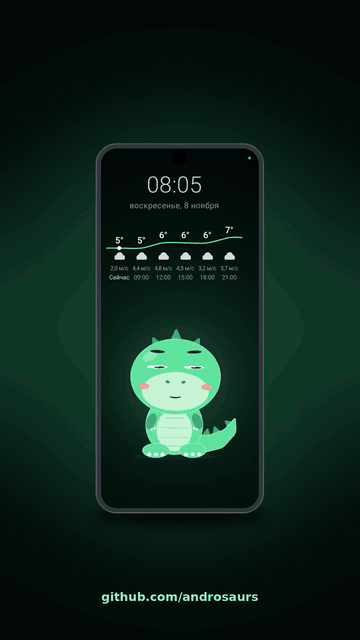

  

# 🦖 Androsaur

**Old Android phones become a home assistant: a living character on the screen that hears its name, recognizes people and speaks.**
Основная часть работает прямо на телефоне, без облака. · *The core runs on the phone itself, no cloud.*

  <a href="https://github.com/androsaurs/androsaur#quick-start"><b>▶ Try it · Попробовать</b></a>
  &nbsp;&nbsp;·&nbsp;&nbsp;
  <a href="https://github.com/androsaurs/.github/blob/main/CONTEXT.md#как-собирать-и-проверять"><b>🔧 Build · Собрать</b></a>
  &nbsp;&nbsp;·&nbsp;&nbsp;
  <a href="https://github.com/androsaurs/androsaur-stand/blob/main/docs/enclosure.md#печать-без-поддержек"><b>🖨 Print the stand · Напечатать подставку</b></a>

> The stand is still a CAD draft: it is not a print-ready kit, and no test print has been made yet.
> Подставка пока черновик: это не готовый к печати комплект, пробной печати ещё не было.

## Modules · Модули

Each module is a small app that is useful on its own; together they are one creature. Every module speaks plain HTTP (and MCP), so an
AI agent can use it directly. · Каждый модуль полезен сам по себе, вместе они одно существо.

| Module | What it does | Что делает | Status |
| --- | --- | --- | --- |
| [androsaur](https://github.com/androsaurs/androsaur) | Main app: the face and seven characters with outfits, clock and weather, knows who is in front, delivers voice notes to the right person, short voice commands, family memory | Главное приложение: лицо и семь персонажей с нарядами, часы и погода, знает, кто перед ним, передаёт записки нужному человеку, короткие голосовые команды, семейная память | working prototype |
| [androsaur-audio](https://github.com/androsaurs/androsaur-audio) | Microphone and voice: wake word with switchable engines, offline Russian speech, voice notes, short commands, MCP | Микрофон и голос: слово пробуждения с переключаемыми движками, русская речь офлайн, голосовые записки, короткие команды, MCP | working prototype |
| [androsaur-camera](https://github.com/androsaurs/androsaur-camera) | Camera service: face tracking, recognizes taught people by a permanent id, document shots, MCP | Камера: слежение за лицом, узнаёт обученных людей по постоянному ID, снимки документов, MCP | working prototype |
| [androsaur-hub](https://github.com/androsaurs/androsaur-hub) | Home server (FastAPI): admin page for settings, people, weather, smart home and memory; syncs faces between phones so a new phone recognizes the family without teaching | Домашний сервер (FastAPI): админка настроек, людей, погоды, умного дома и памяти; синхронизирует лица между телефонами, новый телефон узнаёт семью без обучения | first version, home network only |
| [androsaur-stand](https://github.com/androsaurs/androsaur-stand) | Motorized stand: parametric Python (build123d) model of the pan-tilt mechanism, phone holder and electronics enclosure | Моторизованная подставка: параметрическая модель на Python (build123d): поворотно-наклонный механизм, держатель телефона и корпус электроники | CAD draft, no firmware yet |

Details, APIs and what is not done yet: [CONTEXT.md](https://github.com/androsaurs/.github/blob/main/CONTEXT.md) (written for AI agents).
Faces are kept as numbers, never as photos, on the phones and the home server only.

**License:** the code is [AGPL-3.0](https://www.gnu.org/licenses/agpl-3.0.html): use, change and share it, but any modified
version, including one run as a service, must stay open under the same license. The stand's models and drawings are
[CC BY-NC-SA 4.0](https://creativecommons.org/licenses/by-nc-sa/4.0/), non-commercial. For commercial use, contact the author.
