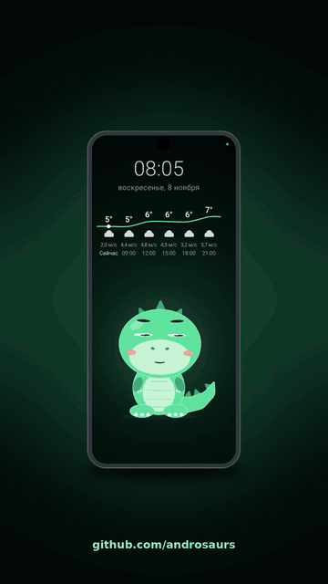
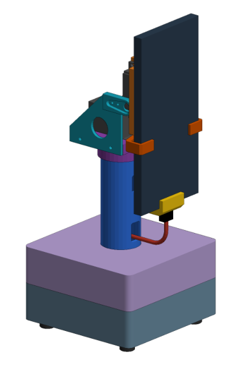

<table align="center">
<tr>
<td valign="middle"></td>
<td valign="middle"></td>
</tr>
</table>

<i>Компаньон на телефоне и подставка, которую для него проектируют (рендер CAD, в работе).</i>

# 🦖 Androsaur

[English](README.md) | **Русский** (перевод основной версии)

**Компаньон для дома, который заботится о тех, кто в нём живёт.**
Старый телефон получает вторую жизнь как маленький живой персонаж. Он сидит рядом, знает, кто перед ним, напоминает отдохнуть и принять
таблетки, передаёт сообщения и помнит семейные мелочи. Почти всё это происходит на самом телефоне, без облака.

  <a href="https://github.com/androsaurs/androsaur/blob/main/README.ru.md#быстрый-старт"><b>▶ Попробовать</b></a>
  &nbsp;&nbsp;·&nbsp;&nbsp;
  <a href="https://github.com/androsaurs/.github/blob/main/CONTEXT.md#как-собирать-и-проверять"><b>🔧 Собрать</b></a>
  &nbsp;&nbsp;·&nbsp;&nbsp;
  <a href="https://github.com/androsaurs/androsaur-stand/blob/main/docs/enclosure.md#печать-без-поддержек"><b>🖨 Напечатать подставку</b></a>

## Знакомьтесь, ваш компаньон

Динозавр на экране дышит, моргает, следит за вами взглядом и разговаривает. Когда никого нет, он засыпает, а просыпается, когда назовёшь
его имя или подойдёшь.

Он знает семью. Когда кто-то появляется, он узнаёт человека и показывает его имя, а у каждого может быть **свой персонаж**: кошечка,
собачка, хомяк, пингвин и другие, некоторые надевают очки по просьбе. При первой встрече за день он здоровается по имени,
рассказывает о погоде («возьми зонт, к вечеру дождь») и, если хотите, о гороскопе.

## Он заботится о вас

- **Цифровое благополучие.** За рабочим столом рядом с вами компаньон, который замечает, как долго вы сидите. Когда пора отдохнуть, он просит встать, размяться или пройтись. Персонаж устаёт, потом выдыхается, а когда вы вернётесь с перерыва, говорит «молодец».
- **Напоминание о таблетках.** У каждого своё расписание. Когда телефон видит вас в нужном интервале, он один раз напоминает принять лекарство и отмечает приём, когда вы скажете «принял». Журнал доходит до домашнего сервера, даже если связь появится позже.

## Он помогает по дому

- **Записки, которые находят нужного человека.** Оставьте кому-нибудь голосовую записку, и она прозвучит, когда этот человек подойдёт к телефону.
- **Память для семьи.** Скажите «запомни, батарейки в верхнем ящике», а потом попросите «вспомни».
- **Сообщение в другую комнату,** оно звучит на умной колонке там.
- **Время, погода, таймеры и быстрый счёт,** ответ сразу.

## Приватность с самого начала

Своё имя и лица распознаёт сам телефон. Лица хранятся как числа, не как фотографии, и только на ваших телефонах и вашем домашнем
сервере. Домашний сервер и онлайн-сервисы необязательны (общие настройки, расшифровка записок, умный дом); без них всё остальное
работает на последних полученных настройках.

## На каком этапе проект

- Компаньон работает как прототип, проверен на Xiaomi Redmi 12 (Android 15).
- Голос сейчас только русский (имя, команды, записки).
- Моторизованная подставка, которая будет поворачивать телефон к вам, ещё в работе: детали напечатаны, дальше сборка электроники, прошивки пока нет.

## Семья Androsaur

| Проект | Простыми словами | Состояние |
| --- | --- | --- |
| [androsaur](https://github.com/androsaurs/androsaur) | Сам компаньон: лицо, семь персонажей, часы и погода, забота и записки | рабочий прототип |
| [androsaur-audio](https://github.com/androsaurs/androsaur-audio) | Его уши и голос: слышит своё имя, понимает короткие команды | рабочий прототип |
| [androsaur-camera](https://github.com/androsaurs/androsaur-camera) | Его глаза: находит лица и знает, кто есть кто | рабочий прототип |
| [androsaur-hub](https://github.com/androsaurs/androsaur-hub) | Необязательный домашний сервер, где семья всё настраивает: людей, персонажей, расписание таблеток, напоминания об отдыхе. Новый телефон сразу узнаёт семью | первая версия, только домашняя сеть |
| [androsaur-stand](https://github.com/androsaurs/androsaur-stand) | Моторизованная подставка для телефона | детали напечатаны, электроника в работе, прошивки нет |

## Лицензия

Открытый код: программы под [AGPL-3.0](https://www.gnu.org/licenses/agpl-3.0.html), модели и чертежи подставки под
[CC BY-NC-SA 4.0](https://creativecommons.org/licenses/by-nc-sa/4.0/) (некоммерчески). Для коммерческого использования свяжитесь с автором.
